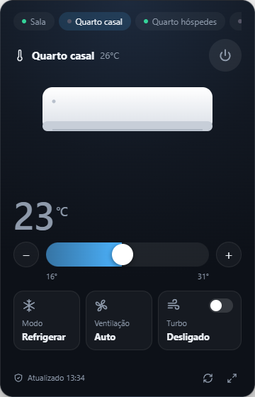
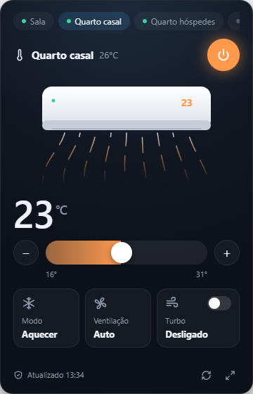
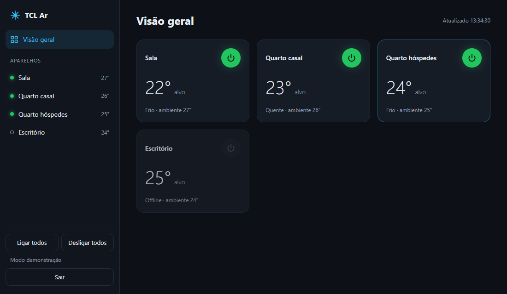

<div align="center">


# TCL Ar

**Controle seus ar-condicionados TCL pelo PC, direto da bandeja do Windows.**

[](https://github.com/mathson123/tcl-ar/releases/latest)
[](https://github.com/mathson123/tcl-ar/actions/workflows/security.yml)
[](LICENSE)


</div>

> [!WARNING]
> **Projeto não oficial.** Não é da TCL, não é afiliado, patrocinado nem aprovado pela TCL.
> "TCL" e "TCL Home" são marcas de seus respectivos donos e aparecem aqui só para indicar compatibilidade.

<p align="center">
  
  &nbsp;
  
</p>

Clique no ícone ao lado do relógio e o painel abre em cima da barra de tarefas. Clicou fora, ele some.
Sem abrir o celular, sem abrir navegador.

## O que faz

- **Painel na bandeja** — liga/desliga, temperatura (16–31 °C) com arraste, modo, ventilação e turbo.
- **Vários aparelhos** — abas no topo para trocar de ar; o ícone fica azul quando algum está ligado.
- **Menu rápido (botão direito)** — liga/desliga cada ar, ligar/desligar todos, iniciar com o Windows.
- **Painel completo** — visão geral de todos os aparelhos e funções extras (oscilação, ECO, sono, display, bipe), quando o modelo tiver.
- **Sem conta nova** — usa o mesmo login do app TCL Home.

<p align="center"></p>

## Compatibilidade

| App que você usa no celular | Funciona |
|---|:---:|
| **TCL Home** | ✅ |
| TCL Smart / Smart Life (Tuya) | ❌ |
| Intelligent AC (BroadLink) | ❌ |

- Testado com **split TCL Inverter** vendido no Brasil.
- O aparelho precisa estar cadastrado no app TCL Home do celular (o primeiro pareamento no Wi-Fi ainda é por lá).
- Windows 10 ou 11, 64 bits.

Testou em outro modelo? [Abre uma issue](https://github.com/mathson123/tcl-ar/issues) contando o modelo (etiqueta da unidade interna) e se funcionou.

## Instalar

1. Baixe o **`TCL-Ar-Setup-x.y.z.exe`** em [Releases](https://github.com/mathson123/tcl-ar/releases/latest).
2. Rode o instalador. Ele mostra os termos (não oficial + compatibilidade) e você precisa aceitar.
3. No fim, o app abre direto no login: use o **mesmo e-mail e senha do TCL Home**.

> [!NOTE]
> O instalador ainda não tem assinatura digital, então o Windows SmartScreen pode avisar na primeira vez.
> Clique em **Mais informações → Executar assim mesmo**. O instalador é gerado pelo
> [GitHub Actions](https://github.com/mathson123/tcl-ar/actions/workflows/release.yml) a partir deste código, e você pode conferir o build.

## Privacidade e segurança

- Seu e-mail e senha vão **só para os servidores da TCL**, no login — o mesmo caminho do app oficial.
- No PC fica salvo apenas o e-mail e o hash MD5 da senha (que é o formato que a TCL recebe), em
  `%APPDATA%\tcl-ar\session.json`. O botão **Sair** apaga o arquivo.
- Nenhum dado vai para outro servidor. Sem telemetria, sem analytics.
- O servidor interno do app escuta só em `127.0.0.1` e recusa pedidos de outros sites.
- CI de segurança em todo push: busca de segredos (gitleaks), `npm audit` e self-test.

## Como funciona

Os aparelhos com TCL Home **não aceitam comando pela rede local** — eles conversam só com a nuvem da TCL,
que roda na AWS. O app faz o mesmo caminho do celular:

```
login TCL  →  tokens da nuvem TCL  →  credencial temporária (AWS Cognito)  →  "shadow" do aparelho (AWS IoT)
```

Ler o shadow traz o estado atual (ligado, temperatura, modo…); escrever nele manda o comando, e o ar recebe pela internet.
Por isso funciona mesmo atrás de roteador, double NAT ou firewall, sem abrir porta nenhuma.

## Limitações

- **Não oficial:** a TCL pode mudar a API a qualquer momento e o app parar de funcionar até ser atualizado.
- **Depende da internet** e da nuvem da TCL (se o app TCL Home estiver fora, este também fica).
- **Modos por modelo:** o app usa a ordem padrão dos split TCL (Auto, Refrigerar, Desumidificar, Ventilar, Aquecer).
  Modelos sem algum desses modos podem usar outra numeração — se um botão ativar o modo errado, abra uma issue com o modelo.
- Só Windows por enquanto.

## Desenvolvimento

Requer Node.js 22+.

```bash
npm ci
npm start                 # roda o app na bandeja
npm start -- --demo       # 4 aparelhos falsos, sem conta (bom para mexer na interface)
npm run selftest          # confere a assinatura AWS SigV4 contra o vetor oficial da AWS
npm run dist              # gera o instalador em dist/
node scripts/icon.mjs     # regenera build/icon.png e build/icon.ico
```

| Arquivo | O quê |
|---|---|
| `main.mjs` | Electron: ícone da bandeja, painel suspenso, menu |
| `server.mjs` | Cliente da nuvem TCL + AWS (SigV4 sem dependências) e API local |
| `public/tray.html` | Painel suspenso |
| `public/index.html` | Painel completo |
| `build/license.txt` | Termos mostrados no instalador |

Publicar versão: `git tag v1.0.1 && git push origin v1.0.1` — o workflow `release` roda o security,
gera o instalador no Windows e cria o Release.

PRs são bem-vindos. Para suporte a outro modelo, o mais útil é o `state` que o app recebe do aparelho
(painel completo → atualizar; ou `GET http://127.0.0.1:8765/api/devices`). **Apague e-mail e IDs antes de colar.**

## Créditos

O protocolo da nuvem TCL Home foi documentado pelo projeto
[ha-tcl-home-unofficial-integration](https://github.com/nemesa/ha-tcl-home-unofficial-integration) (MIT),
uma integração para Home Assistant. Este app é uma implementação própria em Node.js/Electron baseada nesse trabalho.

## Licença

[MIT](LICENSE). Sem garantia de qualquer tipo — use por sua conta e risco.
